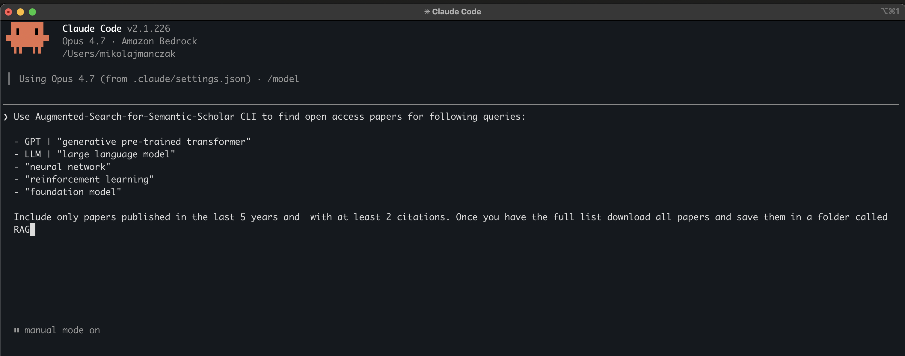

## Context

[Semantic Scholar](https://www.semanticscholar.org/) is an open-access academic search engine developed by the Allen Institute for AI. 
It helps researchers discover relevant papers and explore citations.

## Problem

Exploratory research (or constructing a RAG) often requires performing multiple searches for multiple phrases. Doing this can be time consuming and also results in overlapping results (duplicates).

## Solution

This tool automates the process by:
- UI to enter all queries at once
- Searching Semantic Scholar for each phrase
- Combining all results
- Removing duplicates
- Returning a single, clean list


## Web

Web client is publicly available at [https://mikomanczak.github.io/Augmented-Search-for-Semantic-Scholar](https://mikomanczak.github.io/Augmented-Search-for-Semantic-Scholar) 


Note that this hosted website uses Semantic Scholar without an API key. Semantic Scholar limits unauthenticated users to a shared rate limit of 1,000 requests per second, so searches performed through this website may occasionally fail.

A more reliable way to use the web client is to:

1. [Request an API key](https://www.semanticscholar.org/product/api#api-key)
2. Clone this repository
3. Save your API key in src/web/.env file
4. Run the web client locally

Semantic Scholar requests in the web client automatically retry HTTP 429
responses up to 60 times, waiting a fixed 1 second between retries by default. A valid
`Retry-After` header (seconds or HTTP date) sets the delay instead. If the server
requests a wait longer than 60 seconds, the rate-limit error is shown immediately.
The web client shows an animated retry counter and countdown.
The web client also retries network/CORS failures (shown as “Failed to fetch” by
the browser), since these can hide the HTTP status of a rate-limit response.

### Download open access PDFs

After searching, open **Download** and choose **Download open access PDFs (.zip)**.
The archive contains PDFs from the currently loaded results and a `download-report.json`
listing successes and failures. Duplicate paper IDs and PDF URLs are downloaded once.
Downloads run three at a time, with a 20 MB limit per PDF and no fixed batch-size
cutoff, and a 30-second timeout per file. Cancel stops the batch without saving an archive.
Publisher landing pages, blocked links and other unavailable files appear in the report.

The GitHub Pages version fetches PDFs directly in the browser. Publishers that do not
allow cross-origin requests cannot be downloaded this way. For better coverage, run
the PDF service locally (Node.js 22.18+):

```sh
cd src/web/backend
npm ci
npm start
```

In another terminal, start the frontend:

```sh
cd src/web/frontend
npm ci
npm run dev
```

For frontend development without Semantic Scholar requests, open the Vite URL with
`?mock_results` to search bundled example data.

Open the URL printed by Vite. The development server forwards PDF requests to
`http://127.0.0.1:3000`. The service follows up to five redirects, validates PDF bytes,
blocks private/reserved network destinations on every hop, pins DNS results to each
connection, and caps active article downloads at six. It parses article HTML to find
PDF metadata, repository download buttons, embedded PDF objects/iframes, and PDF.js
or Google viewer file URLs. It also recognizes observed OJS article download,
DSpace bitstream, Digital Commons, Figshare, and journal PDF routes even when they
do not end in `.pdf`. Relative links respect the page's base URL. Literal button
data URLs and GET download forms are supported; page scripts and POST forms are
never executed. Article PDF metadata and direct files take priority over generic
download links; links labelled as citations, supplements, or datasets are skipped.
At most four candidates per page and six source URLs per article are tried, with
one retry for temporary HTTP 202/429/502/503/504 responses.
`Retry-After` waits longer than two seconds are surfaced instead of retried within
the batch. Source requests share the existing 25-second server deadline.
Metadata responses are limited to 2 MB. The service cannot bypass
publisher authentication or anti-bot restrictions, or discover PDFs from every page.

After the original source, arXiv, and PMC fail, the backend looks up the exact DOI
in OpenAlex and tries its explicitly open-access locations. Direct PDF URLs are
tried before landing pages, with duplicate URLs skipped. The existing six-source
limit applies to publisher/repository sources. OpenAlex metadata has a five-second timeout;
successful lookups are cached for one hour (up to 256 DOIs), and requests are spaced
at least 200 ms apart. Basic lookups need no API key; API quota failures appear in
the download report. This uses OpenAlex's locations API, without calling Unpaywall.

Figshare article pages also use the public Figshare file API to discover PDF
files when the webpage does not expose a working download link. Embargoed records
and files marked as external links are skipped.

To enable OpenAlex's cached PDFs as a final fallback, put an activated key in
`src/web/backend/.env.local` as `OPENALEX_API_KEY=your-key`, then restart the backend.
`npm start` loads this ignored file; hosted deployments can set the environment
variable directly. The key stays on the server and is excluded from download
reports and source headers. Cached downloads require an exact DOI match and the
matching OpenAlex work's advertised content URL. One cached-file request is allowed
after the six source attempts; all requests still share the 25-second deadline.
Content requests consume the OpenAlex key's daily allowance. Without a key, cached
files are skipped and the other fallbacks continue to work.

The ZIP report includes final source URLs for successful downloads and attempted
source URLs with failure reasons for unsuccessful downloads.

Fresh Semantic Scholar searches request `externalIds` (DOI, arXiv, and PubMed
Central) alongside the PDF link. If the original source fails, the backend tries
a matching arXiv PDF and then a matching PMC article from NLM's public Cloud
Service. When only a DOI is available, PMC's ID Converter can find the matching
PMCID first. Repository lookups run only after the original source fails, share
the same 25-second deadline, and require no extra API key or Unpaywall setup.
The six-source limit reserves attempts for repositories when identifiers are
available. PMC metadata lookups have a five-second limit and inspect at most two
article versions. The ZIP report preserves the identifiers and the final PDF URL;
repository copies may be preprints or accepted manuscripts. Rerun searches made
before this feature to load their identifiers.

PMC files are retrieved from the NLM PubMed Central Article Datasets. The backend
uses the current versioned Cloud Service and its article metadata, rather than
the retired OA Web Service or scraped PMC article pages. See the
[PMC Cloud Service documentation](https://pmc.ncbi.nlm.nih.gov/tools/pmcaws/).

To use a separately hosted PDF service, set `VITE_PDF_API_URL` to its full
`https://your-service.example/api/pdfs` endpoint before building the frontend, or set
the repository Actions variable `VITE_PDF_API_URL` for the GitHub Pages build. Set
`PDF_ALLOWED_ORIGINS` on the service to a comma-separated list of approved website
origins (for example `https://mikomanczak.github.io`). Localhost origins are allowed
for development. `HOST` defaults to `127.0.0.1`; use `HOST=0.0.0.0` when your hosting
platform requires it, and set `PORT` as needed. For public hosting, apply access and
request-rate limits at your gateway; CORS is not authentication. Keep the API URL
on HTTPS when serving the frontend over HTTPS.

Run `npm test` in each directory to check the archive flow and download protections;
run `npm run build` in each directory to check TypeScript and build the app.

### Experimental headless-browser downloads

The backend includes a separate Playwright experiment for PDFs that still fail.
It is not invoked by normal downloads. Install Chromium and run it against either
a ZIP download report or a comparison report:

```sh
cd src/web/backend
npx playwright install chromium
npm run test:browser
npm run experiment:browser -- /path/to/download-report.json /tmp/pdf-browser-experiment
```

The experiment retries failed papers sequentially in fresh browser profiles. It
can execute article-page JavaScript, follow rendered PDF links, click PDF download
buttons, and capture PDF responses or downloads. It does not use the user's browser
profile, log in, solve CAPTCHAs, or print webpages to PDF. Validated PDFs and an
incrementally saved `browser-fallback-report.json` are written to the output directory.

Each job has a 20-second deadline, up to three navigations, a 20 MB PDF limit, and a
50 MB browser transfer budget. The default rendering wait is two seconds per page;
set `BROWSER_RENDER_WAIT_MS=8000` to allow up to eight seconds for slower pages.
`PLAYWRIGHT_BROWSERS_PATH` can select a custom Chromium installation directory.
An authenticated local proxy checks every HTTP destination and HTTPS tunnel,
rejects private/reserved destinations, and pins checked DNS addresses. Browser
jobs block POSTs, WebSockets and service workers and disable non-proxied WebRTC.

### Reproducing the OpenAlex location experiment

`npm run experiment:openalex -- <download-report.json> <openalex-response.json> <output-directory>`
tests a saved OpenAlex `/works` response against previously failed papers. It
matches exact DOIs, keeps only locations with `is_oa: true`, skips URLs already
attempted in the baseline report, and saves recovered PDFs plus an incremental
`openalex-download-report.json` with the source's version and license metadata.

## Command Line Interface (CLI)

This tool is also available as a CLI. It's presumably less convenient (and more error prone) for human users but it's easier to use for agentic systems such as Claude Code or OpenAI's Codex. To use with such a tool:

1. Clone this repository
2. (Optionally) request API key and save it in src/cli/.env file 
3. Ask your agent to perform search



## Publication

An early version of this tool was used in _"Methodology for AI-Based Search Strategy of Scientific Papers: Exemplary Search for Hybrid and Battery Electric Vehicles in the Semantic Scholar Database"_ 

[https://www.mdpi.com/2304-6775/12/4/49](https://www.mdpi.com/2304-6775/12/4/49)

